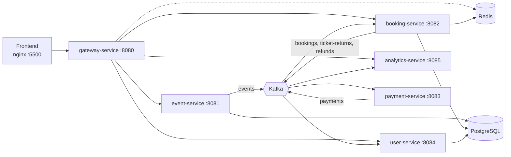

# TicketMaster (PulsePass)

Учебный проект: сервис продажи билетов на концерты, собранный из нескольких микросервисов на Spring Boot. Я делал его не ради самого сервиса, а чтобы на живом примере потрогать то, что обычно остаётся в теории: Kafka между сервисами, распределённые блокировки в Redis, JWT на уровне шлюза, компенсирующие события при возврате билета.

Оплата здесь заглушка (случайный успех/отказ), реальных денег и карт нет. Всё остальное работает по-настоящему: можно зарегистрироваться, выбрать место на схеме зала, "оплатить", увидеть заказ в профиле и вернуть билет.

## Что умеет

- Каталог мероприятий с поиском по артисту, городу и дате
- Схема зала, места подсвечиваются по статусу (свободно, выбрано, занято)
- Регистрация и вход, access и refresh токены
- Бронирование места на 15 минут, оплата, автоматическое снятие брони по таймауту
- История заказов в профиле, возврат билета
- Админка прямо во фронте: создать, изменить и снять с публикации мероприятие (генератор мест: ряды, места в ряду, цена, шаг цены)
- Роли USER и ADMIN, смена роли с записью в аудит-лог
- Простая аналитика: сколько броней, успешных и неуспешных оплат, возвратов
## Архитектура

| Сервис | Порт | За что отвечает |
|---|---|---|
| gateway-service | 8080 | Единая точка входа, проверка JWT, роли, rate limit (Redis), CORS |
| event-service | 8081 | Мероприятия и места, мягкое удаление, публикация событий в Kafka |
| booking-service | 8082 | Брони, статусы мест, блокировки, таймаут брони, возвраты |
| payment-service | 8083 | Имитация оплаты, слушает брони, отвечает результатом в Kafka |
| user-service | 8084 | Пользователи, токены, история заказов, роли, аудит |
| analytics-service | 8085 | Счётчики по событиям из Kafka |
| common-library | - | Общие DTO, `BusinessException`, `JwtValidator`, `Role` |

### Как проходит покупка

1. Админ создаёт мероприятие. `event-service` пишет его в Postgres и отправляет `EVENT_CREATED` в Kafka. `booking-service` по этому событию строит у себя копию мест (проекцию), чтобы не ходить за ними в другой сервис.
2. Пользователь выбирает место, фронт шлёт `POST /api/bookings`. Сервис берёт лок на место в Redis (`SET NX` с TTL), затем читает строку места из БД с pessimistic lock, меняет статус на `RESERVED`, создаёт бронь и кладёт `BookingCreatedEvent` в `ticketmaster.bookings`.
3. `payment-service` подхватывает событие, ждёт 1-2 секунды и с вероятностью 80% отвечает успехом, иначе отказом. Результат уходит в `ticketmaster.payments`.
4. `booking-service` читает результат: при успехе бронь `PAID`, место `SOLD`; при отказе бронь `CANCELLED`, место снова свободно. Пока это происходит, фронт раз в секунду опрашивает статус брони (до 20 секунд).
5. Если оплаты так и не было, планировщик раз в 30 секунд находит просроченные брони (15 минут) и освобождает места.
6. При возврате билета место освобождается, а в Kafka уходит `TicketReturnedEvent`. `user-service` по нему удаляет запись из истории заказов, `analytics-service` увеличивает счётчик возвратов.
7. Если админ снимает мероприятие с публикации, `booking-service` отменяет все активные брони. Для уже оплаченных отправляются события на возврат денег и возврат билета.
### Kafka-топики

| Топик | Кто пишет | Кто читает                         |
|---|---|------------------------------------|
| `ticketmaster.events` | event-service | booking-service                    |
| `ticketmaster.bookings` | booking-service | payment-service, analytics-service |
| `ticketmaster.payments` | payment-service | booking-service, analytics-service |
| `ticketmaster.ticket-returns` | booking-service | user-service, analytics-service    |
| `ticketmaster.refunds` | booking-service | делаю делаю           |

События мероприятий ходят в обёртке `EventEnvelope` (тип + время + JSON-payload), чтобы в один топик можно было класть разные события.

## Стек

- Java 21, Spring Boot 3.2.4, Maven (multi-module)
- Spring Cloud Gateway (WebFlux), reactive Redis для rate limit
- Spring Data JPA / Hibernate, PostgreSQL 16
- Apache Kafka (spring-kafka), Kafdrop для просмотра топиков
- Redis 7: блокировки мест и счётчик запросов на шлюзе
- Spring Security, JWT на jjwt 0.11.5, HS256
- JUnit 5, Mockito
- Frontend: чистый HTML, CSS и JS без фреймворков, раздаётся через nginx
- Docker Compose для инфраструктуры, один общий Dockerfile для сборки любого модуля